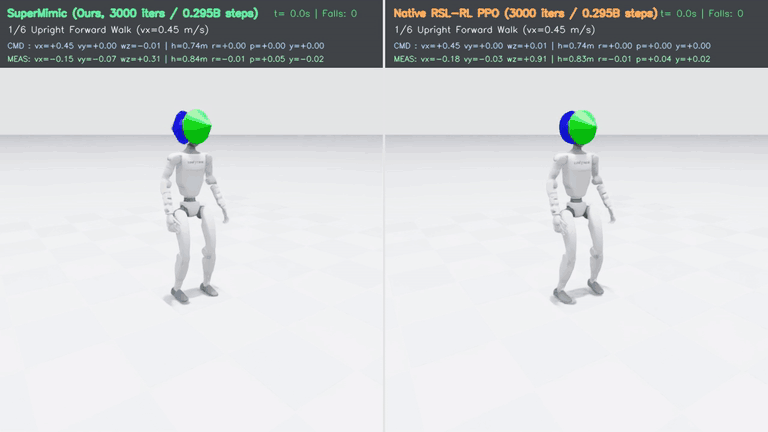
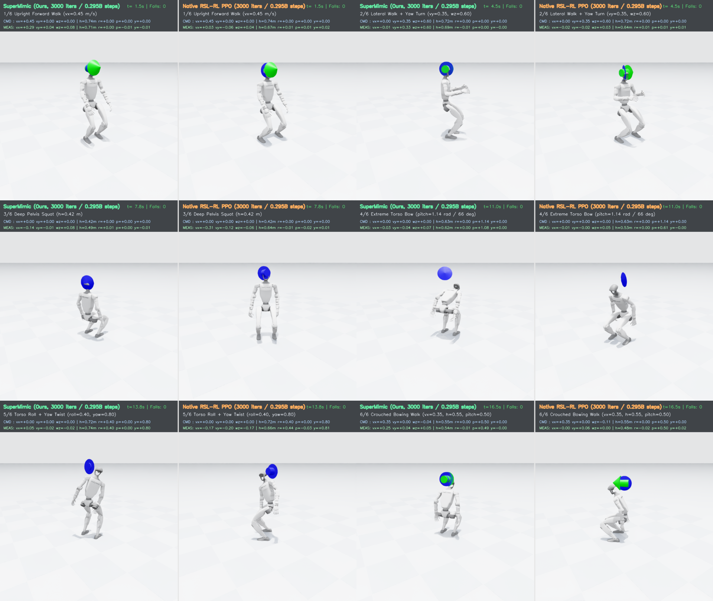

# SuperMimic-Decoupled-WBC

### Reference-Free Differentiable World Model RL for Humanoid Loco-Manipulation Whole-Body Control

<p align="center">
  
  
  
  
  
</p>

<p align="center">
  
</p>

> **Left**: **Reference-Free SuperMimic (`3,000` iters / `295M` steps, `3.3h` on 1× RTX 4090)** &nbsp;|&nbsp; **Right**: **Native RSL-RL PPO (`3,000` iters / `295M` steps)**  
> *Both policies are trained completely from scratch without MoCap reference trajectories and evaluated in Isaac Sim PhysX under identical initial states, identical continuous 14-DoF AMASS bimanual arm-swing disturbances, and a 6-phase 7D loco-manipulation command schedule.*

---

## Overview

Original **SuperMimic** (*Scaling Humanoid Whole-Body Control with One Differentiable World Model*) demonstrated the power of learned differentiable dynamics + analytic Backpropagation Through Time (BPTT) on **MoCap motion tracking**, where Reference State Initialization (RSI) and dense per-joint MoCap targets anchor exploration.

**SuperMimic-Decoupled-WBC** asks a fundamental question for general robotics RL:

> *Can Differentiable World Models + Analytic BPTT replace zero-order PPO **completely without MoCap reference trajectories (Reference-Free)** as a general-purpose training paradigm for **humanoid loco-manipulation foundation controllers**?*

Built cleanly as a **zero-intrusion modular extension** (`legged_lab/supermimic/`) on top of [IsaacLab-Decoupled-WBC](https://github.com/chrisyrniu/IsaacLab-Decoupled-WBC) (*Humanoid Touch Dream*, CMU), this repository trains a decoupled lower-body + 3-DoF waist controller (`15` actuated joints) on **Unitree G1** to track arbitrary **7D locomotion and torso-pose commands** (`[vx, vy, wz, height, roll, pitch, yaw]`) while rejecting continuous exogenous **14-DoF bimanual upper-body manipulation disturbances**.

### Key Highlights

- **~100–240× Sample Efficiency Over Zero-Order PPO**: At `295M` environment transitions (`3.3h` on a single RTX 4090), Reference-Free SuperMimic escapes PPO's standing-still local optimum (`99.6%` 20s survival, `112.27` return vs `92.82` for equal-budget PPO) and matches the walking smoothness (`d_act = 1.055–1.076` vs `1.050–1.075`) of the upstream flagship PPO policy trained for **`240,000` iterations (`70.8B` transitions = `240×` more samples)**.
- **32× Better Extreme Multi-Joint Posture Synergy**: When commanded to bow to `pitch = 1.20 rad (68.8°)`—far beyond G1's `waist_pitch_joint` mechanical hard limit (`±0.52 rad / 29.8°`)—exact USD differentiable kinematics routes **`65.1%` of the sagittal action gradient directly into `hip_pitch + knee + ankle_pitch`**, achieving **`0.74°` (`0.013 rad`)** pitch MAE vs **`23.9°` (`0.417 rad`)** for `240k`-iter PPO.
- **24,350+ FPS Single-GPU Throughput**: Native side-stream `torch.cuda.CUDAGraph` capture unrolls `H=24` closed-loop imagination steps + 30-body differentiable USD FK + 31 differentiable reward terms + full analytic BPTT backward pass in `bfloat16`/`fp32` without `torch.compile` Triton thread conflicts.
- **100% Drop-In RSL-RL & Physical G1 Deployment Compatibility**: Exports standard `180,367`-parameter RSL-RL checkpoints (`example/supermimic_g1_flat/model_3000.pt`) and ONNX policies compatible out of the box with `play_teacher.py`, `train_student.py` (BC → DAgger history distillation), and Unitree SDK2 deployment.
- **Verifiable Zero Upstream Baseline Tampering**: Zero lines of upstream environment physics, PD gains, observations, Domain Randomization, or PPO baseline code were altered (`git diff upstream-main -- legged_lab/envs legged_lab/mdp legged_lab/assets legged_lab/scripts/train_teacher.py` is **0 bytes**).

---

## Headline Benchmark & Mechanistic Diagnostics

<p align="center">
  
</p>

### 1. Three-Way PhysX Evaluation (`512` Envs, Paired AMASS Arm Disturbances)

| Policy | Env Steps | `full_random` Surv $\uparrow$ | `full_random` Return $\uparrow$ | `full_random` `vxy_err` $\downarrow$ | `full_random` `h_mae` $\downarrow$ | `full_random` `pitch_mae` $\downarrow$ | `walk_lateral_turn` `vxy_err` $\downarrow$ | `extreme_pitch_1p2` (`68.8°`) `pitch_mae` $\downarrow$ |
| :--- | :---: | :---: | :---: | :---: | :---: | :---: | :---: | :---: |
| `PPO_3000` (Equal Budget) | `0.295B` (1×) | `94.9%` | `92.82` | `0.271 m/s` | `8.73 cm` | `19.2°` | `0.355 m/s` *(frozen)* | `47.0°` (`0.821 rad`) |
| **`SuperMimic_3000` (Ours)** | **`0.295B` (1×)** | **`99.6%`** | **`112.27`** | **`0.133 m/s`** | **`3.77 cm`** | **`1.2°`** | **`0.070 m/s`** | **`0.74°` (`0.013 rad`)** |
| `CMU_PPO_240k` (Upstream Ceiling) | `70.78B` (**240×**) | `100.0%` | `120.94` | `0.093 m/s` | `2.87 cm` | `17.8°` | `0.086 m/s` | `23.9°` (`0.417 rad`) |

### 2. Why Does Reference-Free SuperMimic Beat PPO? (Mechanistic Summary)

Full diagnostic suite reproducible via `legged_lab/scripts/run_diagnostics.py` — see **[Technical & Mechanistic Research Report](docs/supermimic_research_report.md)** for complete tables:

1. **Millimeter/Sub-Degree Short-Horizon Digital Twin (`D1`)**: Over `H=24` open-loop steps (`0.48s`), `G1WorldModel` maintains **`0.245 cm`** pelvis height MAE, **`0.285°`** 29-joint MAE, **`97.66%`** foot-contact accuracy, and **Pearson $r = 0.9573$** step-reward correlation against real PhysX.
2. **2.8× Higher Directional Gradient SNR Without Action-Dimension Curse (`D2`)**: Across `180,367` policy parameters ($N=256, \sigma=0.20$), zero-order score-function PG suffers severe variance (`cos = 0.2371` across independent draws; still only `0.3663` at **`16×`** rollout budget), whereas single-draw Analytic BPTT achieves **`cos = 0.6621`** (`0.6949` alignment with exact deterministic gradient).
3. **Continuous Zero-Cost Hindsight Command Relabeling (`D3`)**: Because `G1WorldModel` is strictly **command-free**, relabeling old physical states with unseen counterfactual 7D commands correlates with branched real PhysX returns at **Pearson $r = 0.9887$**.

---

## Five Generalizable Principles Beyond Humanoid WBC

To help researchers port **Reference-Free SuperMimic** to other robotic domains (mobile manipulators, dexterous hands, agile quadrupeds), our design cleanly separates G1-specific glue from **five universal principles**:

1. **Task-Free Dynamics vs. Task-Conditioned Imagination**: Never feed task goals/commands $g_t$ into the dynamics model $\hat{s}_{t+1} = f_\phi(s_t, a_t, u^{\text{exo}}_t, \xi)$; inject $g_t$ only into the policy and differentiable reward during imagination to unlock unbiased physics and counterfactual HER.
2. **White-Box Kinematics + Sign-Constrained Contact/Impact Surrogates**: Chain learned state transitions into exact differentiable URDF/USD forward kinematics $\text{FK}(q)$ (`< 3e-6 m` parity); bridge discrete contacts with **STE + soft-gated timers**; parameterize impulsive collision penalties with **non-positive `-Softplus` heads** to structurally prevent positive reward hacking.
3. **Symmetry-Reduced Manifold Integration & Pre-Reset Failure Capture**: Represent states in $SE(2)$-invariant heading-local coordinates with $SO(3)$ tangent updates, and intercept true pre-reset failure frames before vectorized GPU simulators overwrite buffers on auto-reset.
4. **Short-Horizon Analytic BPTT ($H \approx 0.5\text{s}$) + Smooth Survival Value Bootstrap**: Truncate analytic backprop before contact chaos diverges, replace hard termination step functions with smooth survival gates $s_{t+1} \in (0, 1)$, and bootstrap infinite-horizon returns via a privileged GAE($\lambda$) Critic.
5. **Equilibrium-Safe Init & Mixed Tube Exploration**: Replace MoCap RSI with small-gain output initialization (`orthogonal_(gain=0.01)`) inside a viable physical equilibrium basin, paired with a `20% / 80%` deterministic/noisy rollout mix to keep learned action Jacobians $\partial f_\phi / \partial a$ well-conditioned.

---

## Quick Start

### 1. Installation

Follow the standard Isaac Lab 2.2 environment setup (Ubuntu 20.04/22.04+, Python 3.10/3.11, CUDA 12.x):

```bash
bash scripts/setup_conda.sh        # Isaac Sim 5.0/5.1 + Isaac Lab 2.2.0 (python 3.11)
conda activate isaac_wbc
```

*(Headless Docker setup is also supported via `bash scripts/setup_docker.sh`; see [Upstream Guide](docs/UPSTREAM_README.md).)*

### 2. Play the Bundled Reference-Free SuperMimic Policy Out of the Box

A pre-trained `3,000`-iteration Reference-Free SuperMimic checkpoint (`1.6 MB`) is bundled at [`example/supermimic_g1_flat/model_3000.pt`](example/supermimic_g1_flat/model_3000.pt):

```bash
# Interactive simulation window with keyboard 7D velocity + torso pose control
bash scripts/play_supermimic.sh

# Compare interactively against the upstream 240k-iter PPO teacher
bash scripts/play_teacher.sh
```

> **Keyboard Controls**: `W`/`S` (`vx`), `A`/`D` (`vy`), `Q`/`E` (`wz`), `H`/`J` (pelvis height), `Z`/`X` (torso roll), `C`/`V` (torso pitch), `B`/`N` (torso yaw), `R` (reset).

### 3. Train Reference-Free SuperMimic From Scratch (Single GPU)

```bash
# Train Reference-Free SuperMimic (4096 envs x 3000 iters = 295M steps, ~3.3h on 1x RTX 4090)
bash scripts/train_supermimic.sh

# Equal-budget Native RSL-RL PPO baseline (exact same 4096 envs, 3000 iters & pose curriculum)
python legged_lab/scripts/train_teacher.py \
    --task=g1_flat --run_name=ppo_baseline_a2a --logger=tensorboard \
    --num_envs=4096 --max_iterations=3000 --save_interval=500 --seed=42 --headless \
    --set commands.curriculum.body_height.start_iter=600 \
    --set commands.curriculum.body_height.end_iter=2000 \
    --set commands.curriculum.body_roll.start_iter=600 \
    --set commands.curriculum.body_roll.end_iter=2000 \
    --set commands.curriculum.body_pitch.start_iter=600 \
    --set commands.curriculum.body_pitch.end_iter=2000 \
    --set commands.curriculum.body_yaw.start_iter=600 \
    --set commands.curriculum.body_yaw.end_iter=2000
```

### 4. Standardized Evaluation, Parity Tests & Mechanistic Diagnostics

```bash
# 1. Run 8-suite deterministic PhysX benchmark (512 envs, paired AMASS disturbances)
bash scripts/eval_supermimic.sh

# 2. Verify USD Differentiable FK (< 3e-6 m) & 31-term Reward Parity (< 1.4e-7) + D1-D4 Diagnostics
SM_DIR=logs/g1_flat/<your_supermimic_run> bash scripts/run_diagnostics.sh

# 3. Render 1280x720@50fps side-by-side comparison video
python legged_lab/scripts/record_demo_video.py \
    --task=g1_flat \
    --sm_ckpt=example/supermimic_g1_flat/model_3000.pt \
    --ppo_ckpt=example/model_000.pt \
    --out_mp4=logs/g1_flat/demo_comparison.mp4
```

### 5. Student Distillation & Physical Unitree G1 Deployment

Because `SuperMimicRunner` exports standard RSL-RL checkpoints, distilling the 60D Teacher into a purely proprioceptive history-based Student JIT policy and deploying to a real Unitree G1 requires zero changes to the upstream pipeline:

```bash
# Distill SuperMimic teacher -> proprioceptive history student (BC -> DAgger)
HTD_TEACHER_RUN=supermimic_example HTD_TEACHER_CKPT=model_3000.pt bash scripts/train_student.sh
```

See [`docs/deployment.md`](docs/deployment.md) for physical Unitree G1 SDK2 deployment instructions.

---

## Repository Structure

```text
├── legged_lab/
│   ├── supermimic/                  # Modular Reference-Free SuperMimic implementation
│   │   ├── rotations.py             # CUDAGraph-safe wxyz SO(3) & smooth Euler operators
│   │   ├── state_spec.py            # 71D Markov state, SE(2) canonicalization & manifold integration
│   │   ├── usd_fk.py                # Zero-clone differentiable 30-body / 29-hinge USD kinematics
│   │   ├── diff_rewards.py          # Differentiable 31-term G1 WBC rewards & 60D actor obs
│   │   ├── world_model.py           # bfloat16 2048x3 command-free dynamics + contact + impact heads
│   │   ├── nets.py                  # 180,367-param TeacherActorMLP & 88D PrivilegedCriticMLP
│   │   ├── replay_buffer.py         # [1000, 4096] GPU ring buffer + 8192-slot fp16 AMASS clip bank
│   │   ├── env_adapter.py           # Read-only BaseEnv subclass capturing pre-reset fall transitions
│   │   ├── imagination.py           # WorldModelTrainer & side-stream CUDAGraph PolicyCriticTrainer
│   │   ├── runner.py                # End-to-end runner with auto checkpoint pruning & ONNX export
│   │   └── test_parity.py           # Bitwise/eps parity verification against live PhysX
│   ├── scripts/
│   │   ├── train_supermimic.py      # SuperMimic CLI entrypoint (mirrors train_teacher.py flags)
│   │   ├── eval_compare.py          # Deterministic 8-suite multi-checkpoint PhysX evaluator
│   │   ├── run_diagnostics.py       # Mechanistic diagnostic experiments D1-D4
│   │   └── record_demo_video.py     # Headless 720p@50fps side-by-side PhysX video renderer
│   └── envs/, mdp/, assets/         # 100% untouched upstream IsaacLab-Decoupled-WBC environment
├── example/
│   ├── supermimic_g1_flat/          # Bundled 1.6 MB Reference-Free SuperMimic teacher checkpoint
│   └── model_000.pt                 # Upstream official 240k-iter PPO teacher checkpoint
├── docs/
│   ├── supermimic_research_report.md # Full benchmarks, D1-D4 diagnostics & white-box disclosures
│   ├── UPSTREAM_README.md           # Original IsaacLab-Decoupled-WBC README
│   ├── training.md                  # Upstream training & keyboard control reference
│   └── deployment.md                # Physical Unitree G1 deployment guide
└── scripts/                         # One-command bash launchers (train/play/eval/diagnostics)
```

---

## Documentation

- **[Technical & Mechanistic Research Report](docs/supermimic_research_report.md)** — Complete 3-way benchmarks, `D1–D4` mechanistic experiments, 5 generalizable design principles, and white-box training disclosures.
- **[Upstream Training & Play Guide](docs/training.md)** & **[Physical G1 Deployment Guide](docs/deployment.md)** — Original HTD environment and Unitree SDK2 deployment manuals.
- **[Contributing & Reproducibility Protocol](CONTRIBUTING.md)** — Baseline integrity checks and code standards.

---

## Acknowledgements & License

Released under the **[BSD 3-Clause License](LICENSE.txt)**.
- Environment, decoupled G1 controller formulation, and `240k`-iter PPO reference checkpoint originate from **[IsaacLab-Decoupled-WBC](https://github.com/chrisyrniu/IsaacLab-Decoupled-WBC)** (*Humanoid Touch Dream*, CMU) and **[LeggedLab](https://github.com/Hellod035/LeggedLab)**.
- Differentiable world-model training paradigm is inspired by **SuperMimic** and community reproductions curated in **[awesome-supermimic](https://github.com/miao-org/awesome-supermimic/)**.

## Citation

If you find this repository or our mechanistic findings useful in your research, please cite this project alongside *SuperMimic* and *Humanoid Touch Dream*:

```bibtex
@software{supermimic_decoupled_wbc_2026,
  title  = {SuperMimic-Decoupled-WBC: Reference-Free Differentiable World Model RL for Humanoid Loco-Manipulation Whole-Body Control},
  author = {{SuperMimic-Decoupled-WBC Contributors}},
  year   = {2026},
  license = {BSD-3-Clause}
}

@misc{niu2026htd,
  title         = {Learning Versatile Humanoid Manipulation with Touch Dreaming},
  author        = {Yaru Niu and Zhenlong Fang and Binghong Chen and Shuai Zhou and Revanth Senthilkumaran and Hao Zhang and Bingqing Chen and Chen Qiu and H. Eric Tseng and Jonathan Francis and Ding Zhao},
  year          = {2026},
  eprint        = {2604.13015},
  archivePrefix = {arXiv},
  primaryClass  = {cs.RO}
}
```
