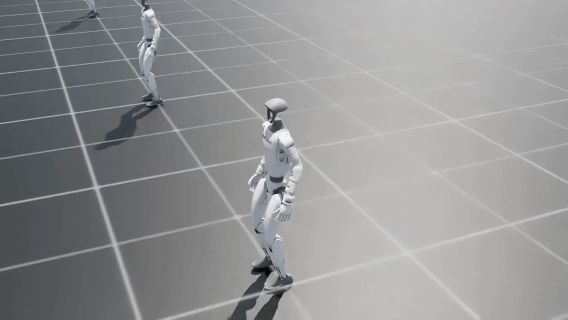

# IsaacLab-Decoupled-WBC

<p align="center">
  <a href="https://humanoid-touch-dream.github.io/wbc_mujoco/dist/index.html">
    
  </a>
</p>

<p align="center">
  
</p>

IsaacLab-Decoupled-WBC is an [Isaac Lab](https://github.com/isaac-sim/IsaacLab)-based framework for training and deploying decoupled whole-body / lower-body controllers for humanoid locomotion. It provides training environments, teacher-policy training, student-policy distillation, interactive policy rollouts in simulation, and physical-robot deployment utilities. The full training pipeline can be completed on a single GPU.

The controller tracks locomotion commands (forward velocity, lateral velocity, yaw rate) together with torso pose commands (height, roll, pitch, yaw). In the maintained deployment path, the student policy controls the lower body and waist while the upper-body joints are kept at configured default positions.

This controller stack was used for the Unitree G1 humanoid experiments in [Humanoid Touch Dream](https://humanoid-touch-dream.github.io/) (HTD).

## Quick Start

### 1. Install

**Option A — Conda**

Requirements: Ubuntu 20.04+, Python 3.10+, CUDA 12.x, and an NVIDIA GPU.

```bash
bash scripts/setup_conda.sh        # Isaac Sim 5.0 + Isaac Lab 2.2.0 (python 3.11)
# bash scripts/setup_conda.sh 4.5  # Isaac Sim 4.5 + Isaac Lab 2.1.0 (python 3.10)
conda activate isaac_wbc
```

**Option B — Docker (headless)**

Requirements: Linux x86_64, an NVIDIA GPU with a compatible driver, Docker, and the
[NVIDIA Container Toolkit](https://docs.nvidia.com/datacenter/cloud-native/container-toolkit/latest/install-guide.html).
From the repository root, run:

```bash
bash scripts/setup_docker.sh
```

The script pulls `chrisyrniu/htd-wbc:isaaclab-2.2.0`, mounts this repository,
stores Isaac Sim's runtime cache under `~/.cache/htd-wbc/isaac-sim-5.0`, and
opens a shell inside the container. Use the Conda installation for interactive
simulation windows.

### 2. Run

The repository ships an example teacher checkpoint and distilled student under
[`example/`](example/), so the **play** scripts run out of the box without
training first.

```bash
# Play a teacher policy in simulation
bash scripts/play_teacher.sh

# Play a student policy (JIT) in simulation
bash scripts/play_student.sh

# Train a teacher policy from scratch (defaults to W&B logging)
bash scripts/train_teacher.sh

# Distill a student from a teacher checkpoint (one-command BC -> DAgger)
bash scripts/train_student.sh
```

> The `play_*` scripts open a simulation window (not headless), where you can drive the
> robot from the keyboard — `W`/`A`/`S`/`D` for velocity, `Q`/`E` for yaw, `H`/`J` for
> height, `Z`/`X`/`C`/`V`/`B`/`N` for torso orientation, `R` to reset. Full mapping in the
> [keyboard controls](docs/training.md#simulation-keyboard-controls) section.

> The training scripts log to Weights & Biases by default; append `--logger=tensorboard`
> to use TensorBoard instead. For all options, overrides, resuming, and monitoring, see
> the [Training & Play Guide](docs/training.md).

To deploy a trained student policy on a physical Unitree G1, see the [Deployment Guide](docs/deployment.md).

## Documentation

- **[Training & Play Guide](docs/training.md)** — train, resume, and play teacher and student policies in simulation, customize training configurations, use keyboard controls, and understand the observation spaces.
- **[Deployment Guide](docs/deployment.md)** — install Unitree SDK2, configure the robot connection, run a student policy on a physical G1, and pair a custom JIT policy with its deployment configuration.

## Acknowledgements

This project is built upon [LeggedLab](https://github.com/Hellod035/LeggedLab).

## Citation

If you use this controller stack in your research, please cite [Humanoid Touch Dream](https://humanoid-touch-dream.github.io/pdfs/humanoid_touch_dream.pdf):

```bibtex
@misc{niu2026htd,
      title={Learning Versatile Humanoid Manipulation with Touch Dreaming},
      author={Yaru Niu and Zhenlong Fang and Binghong Chen and Shuai Zhou and Revanth Senthilkumaran and Hao Zhang and Bingqing Chen and Chen Qiu and H. Eric Tseng and Jonathan Francis and Ding Zhao},
      year={2026},
      eprint={2604.13015},
      archivePrefix={arXiv},
      primaryClass={cs.RO},
      url={https://arxiv.org/abs/2604.13015},
}
```
