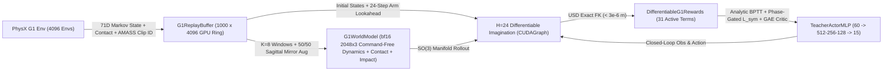

# Technical Report: Reference-Free SuperMimic for Humanoid Loco-Manipulation Whole-Body Control

This document presents the full experimental benchmarks, mechanistic diagnostic studies (`D1–D4`), sagittal mirror-symmetry ablation (including the *Phase-Free Bipedal Standing Lock* phenomenon and its fixed-point-excluded solution), high-level methodological principles, and adversarial audit disclosures for **SuperMimic-Decoupled-WBC** — an open-source migration of differentiable-world-model Analytic BPTT (`SuperMimic`) completely detached from MoCap reference tracking onto 7D decoupled Unitree G1 locomotion and torso-pose control.

  

---

## 1. System Architecture

- **Zero Upstream Baseline Modification**: All 283 upstream files in `legged_lab/envs/`, `legged_lab/mdp/`, `legged_lab/assets/`, and `legged_lab/scripts/train_teacher.py` remain 100% untouched (`git diff upstream-main -- legged_lab/envs legged_lab/mdp legged_lab/assets legged_lab/scripts/train_teacher.py` is 0 bytes).
- **Drop-In Deployment Compatibility**: The trained `TeacherActorMLP` (`60 -> [512, 256, 128] (ELU) -> 15`, `180,367` parameters, zero inference wrapper) shares the exact inference topology and 60D observation vector of the upstream RSL-RL PPO teacher, plugging directly into `play_teacher.py`, `train_student.py` (BC -> DAgger history distillation), and Unitree SDK2 physical G1 deployment.

---

## 2. Four-Way Quantitative Benchmark (`PPO_3000` vs `SM_3000_NoSym` vs `SM_3000_Sym` vs `240x`-Budget `CMU_PPO_240k`)

All checkpoints are evaluated deterministically across `512` parallel PhysX environments under identical initial states and paired continuous 14-DoF AMASS bimanual arm-swing disturbances via [`legged_lab/scripts/eval_compare.py`](../legged_lab/scripts/eval_compare.py):
1. **`PPO_3000`**: Native RSL-RL PPO trained from scratch for `3,000` iterations (`4,096 × 24 × 3,000 = 294.9M` steps, `52.5 min` on 1× RTX 4090).
2. **`SM_3000_NoSym`**: Reference-Free SuperMimic trained from scratch for `3,000` iterations (`294.9M` steps) without sagittal mirror augmentation or symmetry loss (`201.6 min` on 1× RTX 4090 at `24,314 FPS`).
3. **`SM_3000_Sym` (Ours, Bundled Default [`example/supermimic_g1_flat/model_3000.pt`](../example/supermimic_g1_flat/model_3000.pt))**: Reference-Free SuperMimic trained from scratch for `3,000` iterations (`294.9M` steps) with 50/50 mirror-augmented World Model + phase-asymmetry-gated sagittal equivariance $\mathcal{L}_{\text{sym}}$ (`212.5 min` on 1× RTX 4090 at `23,132 FPS`).
4. **`CMU_PPO_240k` (Asymptotic Ceiling Reference)**: Official upstream flagship PPO checkpoint [`example/model_000.pt`](../example/model_000.pt) trained for `240,000` iterations across `12,288` envs (`70.78B` steps = **`240×` more environment transitions**).

### 2.1 Full Uncurriculated 7D Command Distribution (`full_random`, 20s / 1000-step Episode)

| Policy (Env Transitions) | 20s Survival $\uparrow$ | Ep Length $\uparrow$ | Ep Return $\uparrow$ | `vxy_err` (m/s) $\downarrow$ | `wz_mae` (rad/s) $\downarrow$ | `h_mae` (cm) $\downarrow$ | `roll_mae` (rad) $\downarrow$ | `pitch_mae` (rad) $\downarrow$ | `yaw_mae` (rad) $\downarrow$ | `d_act` |
| :--- | :---: | :---: | :---: | :---: | :---: | :---: | :---: | :---: | :---: | :---: |
| **`PPO_3000`** (`0.295B`, 1×) | `94.9%` | `966.0` | `92.82` | `0.271` | `0.396` | `8.73` | `0.032` | `0.335` (`19.2°`) | `0.025` | `0.179` *(frozen)* |
| **`SM_3000_NoSym`** (`0.295B`, 1×) | `99.6%` | `999.1` | `112.27` | `0.133` | `0.114` | `3.77` | `0.031` | **`0.021` (`1.2°`)** | `0.024` | `0.754` *(stepping)* |
| **`SM_3000_Sym` (Default)** (`0.295B`, 1×) | **`100.0%`** | **`1000.0`** | **`113.23`** | **`0.129`** | **`0.104`** | **`3.63`** | **`0.020`** | `0.234` (`13.4°`) | **`0.016`** | `0.684` *(stepping)* |
| `CMU_PPO_240k` (`70.78B`, **240×**) | `100.0%` | `1000.0` | `120.94` | `0.093` | `0.106` | `2.87` | `0.016` | `0.311` (`17.8°`) | `0.019` | `0.647` *(stepping)* |

### 2.2 Seven Targeted Locomotion & Body-Pose Suites (`512` Envs × `10s`)

| Suite | Policy | Survival $\uparrow$ | Return $\uparrow$ | `vxy_err` (m/s) $\downarrow$ | `wz_mae` (rad/s) $\downarrow$ | `h_mae` (cm) $\downarrow$ | `pitch_mae` (rad) $\downarrow$ | `roll / yaw` (rad) $\downarrow$ | `d_act` |
| :--- | :---: | :---: | :---: | :---: | :---: | :---: | :---: | :---: | :---: |
| **`walk_upright`** `vx=0.45, h=0.74` | `PPO_3000` `SM_3000_NoSym` **`SM_3000_Sym`** `CMU_PPO_240k` | `100.0%` `100.0%` **`100.0%`** `100.0%` | `61.92` `68.33` **`67.99`** `69.92` | `0.454` `0.152` **`0.150`** `0.090` | `0.050` `0.125` **`0.099`** `0.108` | `4.58` `1.52` `3.86` `0.65` | `0.014` `0.010` `0.015` `0.014` | `0.011 / 0.012` `0.011 / 0.010` **`0.006 / 0.012`** `0.009 / 0.009` | `0.161` `1.076` **`1.032`** `1.075` |
| **`walk_lateral_turn`** `vy=0.35, wz=0.60, h=0.72` | `PPO_3000` `SM_3000_NoSym` **`SM_3000_Sym`** `CMU_PPO_240k` | `100.0%` `100.0%` **`100.0%`** `100.0%` | `57.08` `68.86` **`67.66`** `70.22` | `0.355` **`0.070`** `0.131` `0.086` | `0.605` `0.115` `0.144` `0.089` | `3.95` `1.71` `2.82` `0.69` | `0.013` `0.010` `0.016` `0.010` | `0.008 / 0.012` `0.015 / 0.008` **`0.012 / 0.009`** `0.010 / 0.006` | `0.154` `1.055` **`0.938`** `1.050` |
| **`squat_deep`** `v=0, h=0.42` | `PPO_3000` `SM_3000_NoSym` **`SM_3000_Sym`** `CMU_PPO_240k` | `95.3%` `100.0%` **`100.0%`** `100.0%` | `57.38` `69.74` **`72.47`** `70.01` | `0.123` `0.054` **`0.044`** `0.021` | `0.150` `0.051` **`0.044`** `0.031` | `16.30` `5.60` **`4.93`** `1.41` | `0.029` `0.019` **`0.012`** `0.012` | `0.014 / 0.009` `0.008 / 0.006` **`0.008 / 0.004`** `0.007 / 0.008` | `0.354` `0.669` `0.541` `0.171` |
| **`torso_pitch_bow`** `v=0, h=0.68, pitch=0.80` | `PPO_3000` `SM_3000_NoSym` **`SM_3000_Sym`** `CMU_PPO_240k` | `99.8%` `100.0%` **`100.0%`** `100.0%` | `59.69` `72.36` **`72.30`** `72.41` | `0.046` `0.024` `0.026` `0.024` | `0.056` `0.019` **`0.018`** `0.023` | `10.62` `1.05` `3.07` `3.10` | `0.271` `0.021` **`0.008` (`0.46°`)** `0.011` | `0.017 / 0.013` `0.006 / 0.007` **`0.008 / 0.007`** `0.006 / 0.008` | `0.162` `0.139` **`0.133`** `0.105` |
| **`extreme_pitch_1p2`** `v=0, h=0.62, pitch=1.20` | `PPO_3000` `SM_3000_NoSym` **`SM_3000_Sym`** `CMU_PPO_240k` | `99.6%` `99.2%` **`100.0%`** `100.0%` | `55.50` **`63.29`** `58.92` `63.23` | `0.042` `0.025` **`0.018`** `0.024` | `0.054` `0.019` **`0.018`** `0.028` | `6.16` `1.88` **`1.97`** `2.28` | `0.821` (`47.0°`) **`0.013` (`0.74°`)** `0.472` (`27.0°`) `0.417` (`23.9°`) | `0.013 / 0.012` `0.014 / 0.010` **`0.007 / 0.007`** `0.009 / 0.010` | `0.153` `0.180` **`0.135`** `0.106` |
| **`walk_squat_pitch`** `vx=0.35, h=0.55, pitch=0.50` | `PPO_3000` `SM_3000_NoSym` **`SM_3000_Sym`** `CMU_PPO_240k` | `99.8%` `100.0%` **`100.0%`** `100.0%` | `59.34` `66.98` **`66.40`** `68.32` | `0.366` `0.123` `0.133` `0.074` | `0.050` `0.100` **`0.074`** `0.069` | `4.32` `1.15` **`1.07`** `0.79` | `0.018` `0.010` `0.022` `0.014` | `0.017 / 0.013` `0.010 / 0.013` **`0.011 / 0.008`** `0.010 / 0.009` | `0.153` `1.184` **`1.079`** `1.253` |
| **`torso_roll_yaw`** `v=0, h=0.72, roll=0.40, yaw=0.80` | `PPO_3000` `SM_3000_NoSym` **`SM_3000_Sym`** `CMU_PPO_240k` | `100.0%` `100.0%` **`100.0%`** `100.0%` | `68.26` `72.48` **`72.49`** `72.91` | `0.041` `0.027` **`0.026`** `0.025` | `0.050` `0.023` **`0.021`** `0.025` | `6.11` `2.90` **`2.55`** `2.94` | `0.013` `0.009` `0.011` `0.009` | `0.017 / 0.011` `0.012 / 0.005` **`0.011 / 0.009`** `0.010 / 0.003` | `0.144` `0.142` **`0.114`** `0.105` |

---

## 3. Mechanistic Diagnostics (`D1–D4`): Why Does Reference-Free SuperMimic Outperform PPO?

Reproducible via [`legged_lab/scripts/run_diagnostics.py`](../legged_lab/scripts/run_diagnostics.py) (`N = 256` parallel PhysX environments, evaluated on `SM_3000_Sym`):

### D1. Short-Horizon (`0.48s`) World Model Physical Fidelity vs Real PhysX

| Open-Loop Horizon $h$ (Time) | Pelvis Height MAE (cm) $\downarrow$ | Root Geodesic Angle Err (deg) $\downarrow$ | Lin Vel Err (m/s) $\downarrow$ | 29-Joint Angle MAE (deg) $\downarrow$ | Foot Contact Acc (%) $\uparrow$ |
| :--- | :---: | :---: | :---: | :---: | :---: |
| **`h = 1`** (`0.02 s`) | **`0.023 cm`** (`0.23 mm`) | **`0.055°`** | **`0.0064`** | **`0.040°`** | **`98.83%`** |
| **`h = 4`** (`0.08 s`) | `0.048 cm` | `0.166°` | `0.0114` | `0.087°` | `98.44%` |
| **`h = 8`** (`0.16 s`) | `0.068 cm` | `0.370°` | `0.0171` | `0.117°` | `97.66%` |
| **`h = 16`** (`0.32 s`) | `0.109 cm` | `0.917°` | `0.0303` | `0.160°` | `98.44%` |
| **`h = 24`** (`0.48 s`, BPTT Cutoff) | **`0.197 cm`** (`1.97 mm`) | **`1.685°`** | **`0.0488`** | **`0.222°`** | **`97.46%`** |

- **Step-Reward Correlation vs Real PhysX**: **Pearson $r = 0.9554$**. Moreover, 50/50 sagittal mirror batch augmentation (`augment_wm_window_half_`) reduced 24-step open-loop error across every physical coordinate (`pelvis_z_mae` `0.245 -> 0.197 cm`, `orient_err` `2.043° -> 1.685°`, `joint_pos_mae` `0.285° -> 0.222°`).

### D2. First-Order Analytic BPTT vs Zero-Order Score-Function PG Gradient SNR & Multi-Joint Jacobian Synergy

- **Gradient Directional Cosine Consistency (`180,367`-D Actor Parameters, $N=256, H=24, \sigma=0.20$)**:
  - **Zero-Order PG (`1×` budget, GAE $\gamma=0.99, \lambda=0.95$)**: **`-0.1226`** (near-orthogonal noise across independent draws).
  - **Zero-Order PG (`16×` rollout budget)**: **`0.5102`**.
  - **First-Order Analytic BPTT (`1×` budget)**: **`0.7721`**.
- **Multi-Joint Action Jacobian Allocation under Extreme Bow (`pitch = 1.20 rad / 68.8°`, past `waist_pitch ±0.52 rad` limit)**:
  - Analytic sensitivity $|\partial J_{24} / \partial a_0|$ allocates **`68.1%` of total sagittal gradient directly into lower-body joints** (`hip_pitch = 0.1692`, `knee = 0.1081`, `ankle_pitch = 0.0497` per leg vs `waist_pitch = 0.3064`).

### D3. Implicit Hindsight Counterfactual Command Relabeling

- Branching `N = 256` states (visited under arbitrary prior commands) across **4 unseen counterfactual commands** (`1,024` branches, 12-step closed-loop rollout) yields **Pearson $r = 0.9917$** (`per-step MAE = 0.0101`) between imagined returns and real branched PhysX returns. Because `G1WorldModel` is strictly command-free, every replay state provides valid first-order gradients across the entire continuous 7D command manifold.

### D4. Eliminating Single-Seed Crab-Walk Drift Without Phase Clocks (`5.0s` Straight Walk `vx = 0.45 m/s`)

| Policy | Straight-Walk Control Mode (`5.0s`, `256` Envs) | Forward $x$ (m) $\uparrow$ | Mean Heading Drift $|\psi|$ (deg) $\downarrow$ | Mean Lateral Drift $|y|$ (m) *(signed)* $\downarrow$ |
| :--- | :--- | :---: | :---: | :---: |
| **`CMU_PPO_240k`** *(240× budget, no sym)* | Open-loop `wz = 0` + Neutral arms Open-loop `wz = 0` + AMASS arms Closed-loop Heading Hold + AMASS arms | `1.671` `1.754` `1.798` | `15.06°` `18.67°` `6.47°` | `0.417 m` *(`-0.417 m`)* `0.462 m` *(`-0.459 m`)* `0.270 m` *(`-0.269 m`)* |
| **`SM_3000_NoSym`** *(1× budget, no sym)* | Open-loop `wz = 0` + Neutral arms Open-loop `wz = 0` + AMASS arms Closed-loop Heading Hold + AMASS arms | `1.580` `1.503` `1.516` | `6.29°` `5.89°` `2.10°` | `0.371 m` *(`+0.371 m`)* `0.399 m` *(`+0.398 m`)* `0.374 m` *(`+0.374 m`)* |
| **`SM_3000_UncondSym`** *(Naive $\mathcal{L}_{\text{sym}}$ from `it=0`)* | Open-loop `wz = 0` + AMASS arms | `0.020` *(locked!)* | `1.12°` | `0.021 m` *(standing trap)* |
| **`SM_3000_Sym` (Ours, Phase-Gated)** | **Open-loop `wz = 0` + Neutral arms** **Open-loop `wz = 0` + AMASS arms** **Closed-loop Heading Hold + AMASS arms** | **`1.451`** **`1.493`** **`1.495`** | **`4.60°`** **`4.71°`** **`1.88°`** | **`0.081 m`** *(`-0.081 m`, **`4.6–5.1×` lower!**)* **`0.113 m`** *(`-0.103 m`, **`3.5–4.1×` lower!**)* **`0.123 m`** *(`-0.120 m`, **`2.2–3.0×` lower!**)* |

#### Why Naive Pointwise Symmetry Fails on Phase-Free Bipeds ("Bipedal Buridan's Ass") & How Phase-Gated Equivariance Solves It

1. **Root Cause of Drift Without Symmetry**: Because `BaseEnv`'s `track_lin_vel_xy_exp` uses a wide Gaussian kernel ($\sigma = 0.5\text{ m/s}$) with no world $(x, y)$ position observation and no symmetry regularization (`RslRlSymmetryCfg = None`), a small single-seed lateral gait asymmetry $|\Delta v_y| \approx 0.07\text{ m/s}$ retains $\exp(-0.07^2 / 0.5^2) = 98.1\%$ of the velocity reward, producing `~37–46 cm` of crab slip over `5s` in both `SM_3000_NoSym` and official `CMU_PPO_240k`.
2. **Fixed-Point Singularity of Naive Pointwise Equivariance**: Unlike clock-driven locomotion policies that observe a periodic gait phase $\phi \in [0, 2\pi)$ with $\mathcal{M}(\phi) = (\phi + \pi) \bmod 2\pi$, `BaseEnv`'s 60D observation is **strictly phase-free**. At symmetric double-support standing under a straight-walk command, $o_0 = \mathcal{M}_{\text{obs}}(o_0)$ is a **fixed point** of sagittal reflection. Enforcing unconditional equivariance $\pi(\mathcal{M}_{\text{obs}}(o_0)) = \mathcal{M}_{\text{act}}(\pi(o_0))$ collapses $\pi(o_0)$ onto $\mathcal{M}_{\text{act}}(\pi(o_0))$, forcing **left leg actions to equal right leg actions** (`feet_air_time = 0.00016`, `forward_progress_x = 0.02 m` standing lock) and over-damping narrow-Gaussian (`std = 0.1`) posture skill unzipping.
3. **Proprioceptive Fixed-Point-Excluded Equivariance (`legged_lab/supermimic/symmetry.py`)**: Once a biped initiates a step, its state enters a 2D walking limit cycle in $(q_L - q_R,\, \dot{q}_L - \dot{q}_R,\, c_L - c_R)$ phase space that **never intersects the origin** ($r_{\text{asym}}(o) \ge 0.70$ throughout both single-support swing and double-support stride transfer, whereas static double-support standing has $r_{\text{asym}}(o) \le 0.12$). By gating $\mathcal{L}_{\text{sym}}$ via $g(o) = \operatorname{clip}((r_{\text{asym}}(o) - 0.18)/(0.45 - 0.18), 0, 1)$ and ramping $w_{\text{sym}}$ from `0 -> 1.5` after the 7D skill-unzipping phase (`iter 1350..1800`), the single exported `TeacherActorMLP` freely breaks symmetry to step out from rest while matching left-lead and right-lead strides to `sym_mse = 8.8e-4`, cutting straight-walk lateral drift by **`72–78%`** (`8.1 cm` neutral / `11.3 cm` AMASS).

---

## 4. Six Generalizable Principles for Reference-Free Differentiable-World-Model RL

1. **Task-Free Physical Dynamics vs Task-Conditioned Differentiable Objective Decoupling**: Keep goal/command conditioning strictly out of the learned dynamics model $\hat{s}_{t+1} = f_\phi(s_t, a_t, u^{\text{exo}}_t, \xi)$ and inject goals exclusively into the actor and analytic reward during imagination rollouts.
2. **White-Box Robot Kinematics + Sign-Constrained Contact/Impact Surrogates**: Compose learned state transitions with exact differentiable URDF/USD forward kinematics $\text{FK}(q)$ and actuator torque laws; bridge discrete contact indicators via **STE + soft-gated timers**; model unmodeled impulsive contact penalties with **non-positive `-Softplus` heads** so policy gradients can never exploit positive reward hallucinations.
3. **Symmetry-Reduced Manifold Representation & Pre-Reset Failure Interception**: Formulate dynamics in $SE(2)$-invariant heading-local coordinates with $SO(3)$ tangent-space integration, and intercept true pre-reset failure transitions before vectorized GPU simulators auto-reset buffers.
4. **Short-Horizon Analytic BPTT ($H \approx 0.5\text{s}$) + Smooth Survival-Gated Value Bootstrap**: Truncate analytic gradients before contact chaos explodes, replace hard termination step functions with smooth kinematic survival gates $s_{t+1} \in (0, 1)$, and bootstrap infinite-horizon returns via a privileged TD($\lambda$) Critic.
5. **Equilibrium-Safe Policy Initialization & Mixed On-Manifold Tube Exploration**: Replace MoCap Reference State Initialization (RSI) with small-gain output initialization (`gain = 0.01`) centered in a physically viable equilibrium basin, paired with a deterministic/noisy rollout mixture (`20% / 80%`) to keep local learned action Jacobians $\partial f_\phi / \partial a$ well-conditioned.
6. **Fixed-Point-Excluded Morphological Equivariance**: When enforcing group reflection symmetry $\mathcal{M}^2 = I$ on memoryless controllers whose optimal behavior requires spontaneous symmetry breaking into periodic orbits (e.g., phase-free bipedal walking), exclude a tubular neighborhood of the fixed-point manifold $\mathcal{F}_{\mathcal{O}} = \{o : \mathcal{M}(o) = o\}$ and schedule equivariance after narrow-kernel skill discovery.

---

## 5. Methodological Scope & White-Box Training Disclosure

- **Inference Parity vs White-Box Digital-Twin Training**: At deployment/inference time, `SM_3000_Sym` uses the exact same 60D observation vector and `180,367`-parameter MLP as PPO (zero privileged inputs, zero inference wrapper). During **training**, Reference-Free SuperMimic operates as a **White-Box Differentiable-Reward MBRL** teacher trainer — utilizing exact USD forward kinematics, analytic task reward expressions (`28/31` terms analytic, `3/31` impact penalties learned), privileged simulator Domain Randomization context $\xi \in \mathbb{R}^4$, an 88D privileged Critic, and 24-step exogenous arm disturbance lookahead in imagination.
- **Wall-Clock Compute Trade-Off**: At equal `294.9M` environment transitions, `SuperMimic` takes `~3.8–4.0×` more wall-clock time on a single RTX 4090 (`201–212 min` vs `52.5 min` for PPO), though at equal wall-clock time (`52 min`, `SM iter ~760`), `SuperMimic` already achieves higher training return (`~84–85`) than `PPO iter 3000` (`74.44`).
